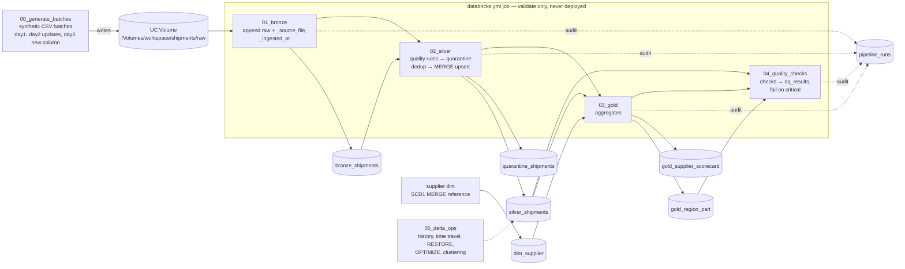

# PLAN — Shipments Lakehouse (learning fork)

Fork of [TAM-DS/databricks-ai-ready-lakehouse](https://github.com/TAM-DS/databricks-ai-ready-lakehouse)
by Tracy Anne Griffin Manning (MIT). Branch: `learning-scaffold`. Local commits only, no push, no deploy.

## 1. What the original author built (kept intact, credited)

| Part | What it does |
|---|---|
| `notebooks/01_bronze_silver_gold.py` (+ `.ipynb` twin) | One notebook: generates 1,260 synthetic shipment events (60 deliberately bad) → `sc_bronze` → SQL quality rules + `ROW_NUMBER` dedup → `sc_silver` / `sc_quarantine` → `sc_gold` (region × part_type) → hard `assert`s (1260 = 1200 + 60). Writes to `<current_catalog>.ai_ready_demo`. |
| `quality_portal/` | Local read-only CSV loader (`core.py`), Gradio dashboard, MCP stdio server over exported CSVs. |
| `tests/test_core.py` | 6 `unittest` tests for the CSV loader (no Spark). |
| Docker / compose / `.github/workflows/tests.yml` | Local packaging of the dashboard; CI runs the offline tests. |
| `docs/` | Architecture, security, validation evidence (author's screenshots). |

Nothing of the above is modified except: README gets a new top section + credits (original README content preserved
as `docs/ORIGINAL_README.md`). The original notebook stays as the "v0" reference and is the first thing you run.

## 2. Target architecture

The single notebook is split into a **multi-task, incremental, testable** pipeline. Data now arrives as
**daily CSV batches in a Unity Catalog volume** (generated by a notebook — no external storage), so we can
practice incremental ingest, MERGE, schema evolution and time travel.



All tables live in `workspace.shipments` (catalog/schema/volume names in one config module, overridable via
notebook widgets / job parameters).

## 3. Modules

```
src/shipments_pipeline/
  config.py        names (catalog, schema, volume, tables), widget/param helpers        [ME]
  generator.py     deterministic synthetic batches (errors, updates, new column)         [ME]
  bronze.py        read CSV batch + metadata cols; incremental file filter               [ME ref | TODO-07]
  quality.py       rule framework + 1 rule + quarantine split; remaining rules           [ME ref | TODO-02]
  silver.py        dedup (TODO-04), MERGE upsert into silver (TODO-08)                    [TODO]
  dims.py          dim_supplier SCD1 MERGE (reference for MERGE pattern); SCD2           [ME ref | TODO-16]
  gold.py          gold_region_part (ref); gold_supplier_scorecard                        [ME ref | TODO-06]
  checks.py        DQ check framework + reconciliation check (ref); more checks, results [ME ref | TODO-09]
  audit.py         log_run(): row counts per task into pipeline_runs                      [ME ref | TODO-13]
notebooks/
  01_bronze_silver_gold.py/.ipynb   ORIGINAL (untouched)
  00_generate_batches.py   10_bronze.py   20_silver.py   30_gold.py   40_quality_checks.py   50_delta_ops.py
  99_run_tests.py          runs pytest on Databricks serverless (no local Java needed)
tests/
  conftest.py              spark fixture (active Databricks session OR local[1])      [ME]
  test_quality.py          1 reference test + TODO tests                               [ME ref | TODO-03,05]
  test_core.py             ORIGINAL
databricks.yml + resources/shipments_job.yml   job with first tasks (ref); rest TODO-14
docs/  TODO.md  CONCEPTS.md  INTERVIEW_PREP.md  ORIGINAL_README.md (+ original docs untouched)
```

Design rules:
- Transforms are pure functions `DataFrame -> DataFrame` in `src/` (unit-testable); notebooks only do I/O + wiring.
- No `spark.sparkContext` / RDD APIs (serverless = Spark Connect). No DBFS paths, no cluster configs.
- Unfinished parts: `raise NotImplementedError("TODO-NN: see docs/TODO.md")`. Notebooks guard TODO steps so the
  reference path still runs end to end on day 1.

## 4. The ~20% I build (one complete reference per pattern)

| Pattern | Reference implementation |
|---|---|
| Config / parameters | `config.py` + widgets in every notebook |
| Synthetic source in a UC volume | `generator.py` + `00_generate_batches` (3 batches) |
| Bronze ingest | `bronze.read_batch()` — CSV → typed DF + `_source_file`, `_ingested_at`, append to Delta |
| Quality rule + quarantine | `quality.py` framework, rule `missing_supplier`, `split_valid_quarantine()` |
| MERGE upsert (SCD1) | `dims.upsert_dim_supplier()` |
| Gold aggregate | `gold.build_region_part()` |
| DQ check | `checks.check_reconciliation()` + check result schema |
| Monitoring | `audit.log_run()` used by bronze task |
| Delta time travel | `50_delta_ops`: `DESCRIBE HISTORY` + `VERSION AS OF` example |
| PySpark unit test | `conftest.py` + `test_missing_supplier_rule` |
| Asset Bundle | `databricks.yml` + job with `generate` → `bronze` tasks (serverless, no clusters) |

## 5. The ~80% you build — learning order (easy → hard)

| # | TODO | Concept taught | Diff | Est. |
|---|---|---|---|---|
| 01 | Run original notebook + reference pipeline (batch 1); inspect tables, `DESCRIBE HISTORY`, `.explain()` | Workspace, serverless, UC, lazy eval | 1 | 30m |
| 02 | Remaining quality rules (quantity, unit cost, date via `try_cast`, status) | Column expressions, null semantics | 1 | 25m |
| 03 | Unit tests for TODO-02 rules | pytest + Spark fixture | 1 | 25m |
| 04 | Dedup: latest event per `shipment_id` (window `row_number`) | Window functions, wide transformation/shuffle | 2 | 25m |
| 05 | Unit test for dedup | Testing transformations | 1 | 15m |
| 06 | `gold_supplier_scorecard` in Spark SQL (join dim, `RANK()`) | SQL joins, CTEs, window ranking | 2 | 30m |
| 07 | Incremental bronze: skip already-ingested files (idempotent rerun) | Idempotency, incremental loads | 2 | 30m |
| 08 | Silver MERGE upsert (batch 2 status updates) using the dim reference | Delta MERGE, upserts | 2 | 40m |
| 09 | 2 more DQ checks + write `dq_results` + fail job on critical | Data quality, fail-fast | 2 | 30m |
| 10 | Schema evolution: batch 3 adds `carrier` column (`mergeSchema` / MERGE schema evolution) | Schema enforcement vs evolution | 2 | 30m |
| 11 | Time travel diff + `RESTORE` after a simulated bad write | Transaction log, recovery | 2 | 20m |
| 12 | `OPTIMIZE` + liquid clustering on silver, compare `DESCRIBE DETAIL` | File layout, small files | 2 | 25m |
| 13 | Audit logging in all tasks + read the query plan (find `Exchange`) | Monitoring, shuffle, Spark UI | 2 | 30m |
| 14 | Complete `databricks.yml` (silver/gold/dq tasks, `depends_on`, params) + `databricks bundle validate` | Jobs/workflows as code | 2 | 30m |
| 15 | Add pytest step to existing GitHub Actions CI (tests only, no deploy) | CI stages | 1 | 20m |
| 16 | Stretch: SCD Type 2 for `dim_supplier` | SCD2, MERGE with history | 3 | 60m |
| 17 | Stretch: broadcast join + skew/AQE observation | Joins, broadcast, AQE | 3 | 30m |
| 18 | Stretch: cost awareness — query `system.billing.usage` (availability on Free Edition **unverified**) | Cost monitoring | 2 | 20m |

**Total ≈ 8½ h** (core 01–15 ≈ 6¾ h, stretch ≈ 1¾ h), plus doc reading.

## 6. Team & workflow

| Agent | Model | Brief |
|---|---|---|
| Implementer A — code | haiku | `src/`, new notebooks, tests, `databricks.yml`, resources. Exact function signatures + TODO template from this plan. |
| Implementer B — learning docs | haiku | `README.md`, `docs/TODO.md`, `docs/CONCEPTS.md`, `docs/ORIGINAL_README.md` — driven by section 5 so it can run in parallel with A. |
| Implementer C — interview prep | haiku | `docs/INTERVIEW_PREP.md` (all requested sections; [PROJECT]/[GENERAL] tags; "(after TODO-NN)"). |
| Reviewer | sonnet | Reviews A, B, C against this plan: Free Edition compatibility, imports/run, TODO order & scope, docs ↔ code match, no fabricated claims. Loop until pass; final cross-check. |

I (Opus) write the specs, resolve review findings, run local checks, and make small commits:
`docs: plan` → `feat: config+generator` → `feat: reference patterns` → `test: ...` → `build: bundle` → `docs: ...`.

## 7. Verification I can and cannot do

- **Can (locally):** Python syntax/import checks, YAML parse, notebook-format checks, existing `unittest` suite.
- **Cannot locally right now:** run PySpark tests — **no Java runtime on this Mac** (and Python is 3.14, newer than
  PySpark supports). Options: (a) you approve `brew install openjdk@17` + a `uv` Python 3.12 venv (outside repo — I'll
  ask first), or (b) run tests on Databricks via `notebooks/99_run_tests`. Plan supports both.
- **Cannot:** run anything on Databricks or `databricks bundle validate` (needs your workspace auth + CLI). Docs will
  say "not verified by the scaffold author" wherever that applies.

## 8. Open risks

- Creating a volume in `workspace` catalog on Free Edition — expected to work (the original creates a schema there), not verified by me.
- Importing `src/` from notebooks in a Git folder: notebooks add the repo root to `sys.path` explicitly to be safe.
- `system.billing.usage` and some Spark UI views may be unavailable/limited on Free Edition serverless — TODO-18 is optional.
- Liquid clustering / predictive optimization behaviour on Free Edition — TODO-12 docs ask you to observe, not assume.
- Original README makes claims about the author's runs; those stay attributed to the author.
