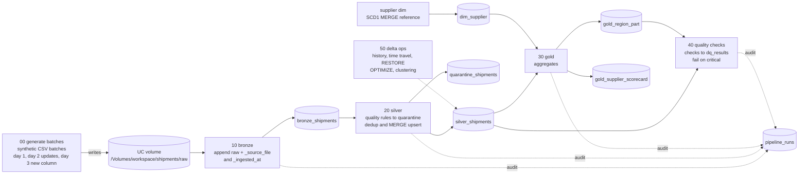

# Shipments Lakehouse: a Databricks learning scaffold

> Learning project — forked & extended. Work in progress: see checklist below.

**Problem.** A supplier network ships parts (transformers, inverters, turbine components, cooling modules) across US regions, and every shipment generates status events. Those events arrive as daily batches, contain bad records (missing suppliers, impossible quantities, unknown statuses) and sometimes repeat or update earlier shipments. The question this project works on: how do you turn messy daily batches into analytics you can trust, with every rejected row kept and explained, every re-run safe, and every table change reversible? The data is fully synthetic.

This repository is a fork of [TAM-DS/databricks-ai-ready-lakehouse](https://github.com/TAM-DS/databricks-ai-ready-lakehouse) by Tracy Anne Griffin Manning (MIT). Her original single notebook is kept as the first thing you run. The rest of the pipeline is split into a multi-task, incremental, testable structure, and most of the Databricks and PySpark work is left for you as TODOs.

---

## Architecture



Everything lives in Unity Catalog under `workspace.shipments` (catalog, schema and volume names are overridable through notebook widgets and job parameters). The scaffold ships the reference path and the job's first two tasks (`generate` → `bronze`). The silver, gold and quality tasks are added by you in TODO-14.

---

## Tech stack

- **PySpark** (DataFrame API only) and **Spark SQL**, including `MERGE`, window functions and `try_cast`
- **Delta Lake** tables, with time travel, `RESTORE`, `OPTIMIZE` and liquid clustering as learning topics
- **Unity Catalog** for three-level table names and a **volume** for the raw CSV batches
- **Databricks serverless notebooks and Jobs** (Spark Connect; no clusters, no DBFS paths)
- **Databricks Asset Bundles**, used for `databricks bundle validate` only
- **pytest** for unit tests, with a local `local[1]` Spark session or the active Databricks session
- **GitHub Actions**, running tests only (no deploy steps): the original offline tests today, with pytest added in TODO-15

---

## Run on Databricks Free Edition

> Not yet verified by the scaffold author on Free Edition. The steps below follow the design; if a step behaves differently for you, please tick the checklist only after you have confirmed it yourself.

1. **Sign up** for Databricks Free Edition (search for "Databricks Free Edition"). Its limits are described in the [Free Edition limitations](https://docs.databricks.com/aws/en/getting-started/free-edition-limitations) docs.
2. **Fork this repository** on GitHub. Your fork URL is `<your-fork-url>` below.
3. In the workspace, go to **Workspace → Create → Git folder** and paste `<your-fork-url>`. See the [Git folders](https://docs.databricks.com/aws/en/repos/) docs.
4. (Optional) Open the original notebook `notebooks/01_bronze_silver_gold` and run it. It is the v0 reference and prints `VALIDATED` when its own assertions pass.
5. Open the notebooks in this order, and **attach Serverless** compute to each one:

   | Order | Notebook | Setting | What it does |
   |---|---|---|---|
   | 1 | `00_generate_batches` | `days = 1` | Writes the day-1 CSV into the volume |
   | 2 | `10_bronze` | | Appends the CSV rows to `bronze_shipments` |
   | 3 | `20_silver` | `supplier_version = 1` | Dim load, quality rules, quarantine, silver |
   | 4 | `30_gold` | | Builds `gold_region_part` |
   | 5 | `40_quality_checks` | | Writes `dq_results` and fails on critical checks |
   | 6 | `50_delta_ops` | | History, time travel, and (after TODO-11/12) restore and clustering |
   | 7 | `60_monitoring` | | Last rows of `pipeline_runs`, plus the TODO-13 and TODO-18 cells |

6. **Expected day-1 reference numbers.** Before you have done any TODO, the reference path should give:

   | Table | Rows |
   |---|---:|
   | bronze_shipments | 1,260 |
   | silver_shipments | 1,248 |
   | quarantine_shipments | 12 |
   | gold_region_part | 16 |

   The 12 quarantined rows are only the `missing_supplier` cases. The other bad rows pass until their rules (TODO-02) and the dedup (TODO-04) are done.

7. **Numbers after all core TODOs** (from `docs/SCAFFOLD_SPEC.md` §1, expected state once the core TODOs are complete):

   | After loading | bronze rows | quarantine rows | silver rows (distinct shipments) | gold_region_part rows |
   |---|---:|---:|---:|---:|
   | day 1 | 1,260 | 45 | 1,200 | 16 |
   | days 1–2 | 1,565 | 50 | 1,300 | 16 |
   | days 1–3 | 1,665 | 50 | 1,350 | 16 |

   The day-1 quarantine count is 45 rather than 12 because the rules from TODO-02 are then active.

8. **Load day 2.** Run `00_generate_batches` with `days = 2`, then `10_bronze` and `20_silver`. In `20_silver`, set `USE_MERGE = True` once TODO-08 is done, so that the day-2 status updates are merged rather than fully rebuilt. Until TODO-07 is done, re-running `10_bronze` re-appends every file in the volume, so bronze duplicates your data.

9. **Load day 3.** Run `00_generate_batches` with `days = 3`, then `10_bronze` and `20_silver`. Day 3 adds a `carrier` column. Without TODO-10, appending it to bronze fails with a schema mismatch. That failure is intended, and TODO-10 is about handling it.

10. **Editing code in `src/`.** The notebooks enable `%autoreload 2`, so edits to `src/shipments_pipeline/*.py` are picked up automatically (expected, not yet verified on Free Edition). If a change does not show up, use **Detach & re-attach** or restart the Python process.

---

## Run tests locally

You need Python 3.12 and Java 17 (PySpark runs on the JVM).

```bash
python3.12 -m venv .venv
source .venv/bin/activate
pip install -r requirements-dev.txt
pytest -q
```

The generator tests are pure Python. The quality and silver tests start a local Spark session (`local[1]`). The tests for TODO-03 and TODO-05 are skipped until you replace the skips with real tests, so a green run before you start means "nothing wrong with what exists", not "the TODOs are done".

To run the same tests on Databricks, attach a notebook to Serverless and run `notebooks/99_run_tests`. That path is not yet verified by the scaffold author on Free Edition.

---

## Bundle (validate only)

The file `databricks.yml` and `resources/shipments_job.yml` describe the job as code. You can check them with:

```bash
databricks bundle validate
```

Install the Databricks CLI first ([CLI install docs](https://docs.databricks.com/aws/en/dev-tools/cli/install)). The [bundles docs](https://docs.databricks.com/aws/en/dev-tools/bundles/) explain the format. `validate` may need CLI authentication to a workspace; that is not yet verified by the scaffold author.

**This project never deploys.** There is no `bundle deploy`, no `bundle run`, no CI deploy step, and no recurring schedule. CI runs tests only: today that is the original offline tests in `tests/test_core.py`; the pytest and PySpark tests join CI in TODO-15.

---

## Project structure

```
databricks-project/
├── README.md                       this file (learning entry point)
├── PLAN.md                         why the scaffold is shaped this way
├── LICENSE                         MIT, Tracy Anne Griffin Manning
├── databricks.yml                  bundle "shipments-lakehouse", validate only
├── resources/
│   └── shipments_job.yml           job shipments_pipeline (generate → bronze, more in TODO-14)
├── notebooks/
│   ├── 01_bronze_silver_gold.py    ORIGINAL v0 notebook (untouched)
│   ├── 01_bronze_silver_gold.ipynb ORIGINAL, notebook import format (untouched)
│   ├── 00_generate_batches.py      synthetic CSV batches into the UC volume
│   ├── 10_bronze.py                incremental CSV → bronze (TODO-07)
│   ├── 20_silver.py                dim load, quality, quarantine, silver (MERGE from TODO-08)
│   ├── 30_gold.py                  gold aggregates (TODO-06, TODO-17)
│   ├── 40_quality_checks.py        DQ checks → dq_results (TODO-09)
│   ├── 50_delta_ops.py             history, time travel, OPTIMIZE (TODO-11, TODO-12)
│   ├── 60_monitoring.py            pipeline_runs, query plan, billing (TODO-13, TODO-18)
│   └── 99_run_tests.py             pytest on Databricks
├── src/shipments_pipeline/         pure functions DataFrame → DataFrame (unit-testable)
│   ├── __init__.py
│   ├── config.py                   names, widgets and parameters
│   ├── generator.py                deterministic synthetic batches (no Spark)
│   ├── bronze.py                   read_batch (ref), list_new_files (TODO-07)
│   ├── quality.py                  rule framework, quarantine split (ref), rules (TODO-02)
│   ├── silver.py                   dedup_latest (TODO-04), merge_into_silver (TODO-08)
│   ├── dims.py                     dim_supplier SCD1 MERGE (ref), SCD2 (TODO-16)
│   ├── gold.py                     build_region_part (ref), build_supplier_scorecard (TODO-06)
│   ├── checks.py                   DQ checks (ref), more checks and fail-fast (TODO-09)
│   └── audit.py                    log_run into pipeline_runs (ref)
├── tests/
│   ├── conftest.py                 spark fixture (active session or local[1])
│   ├── test_generator.py           pure Python, asserts the expected numbers
│   ├── test_quality.py             reference test + TODO-03 tests
│   ├── test_silver.py              TODO-05 test
│   └── test_core.py                ORIGINAL unittest tests for the quality portal
├── quality_portal/                 ORIGINAL local Gradio dashboard and MCP server
├── scripts/                        ORIGINAL helper scripts
├── data/                           ORIGINAL: place for local CSV exports (not committed)
├── docs/
│   ├── TODO.md                     the 18 TODOs, one section each
│   ├── CONCEPTS.md                 Spark and Delta concepts, with pointers into the repo
│   ├── ORIGINAL_README.md          the original README, unchanged apart from a one-line attribution header
│   ├── SCAFFOLD_SPEC.md            the exact build spec the scaffold was written from
│   ├── ARCHITECTURE.md, VALIDATION.md, SECURITY.md   ORIGINAL
│   └── NOTES.md                    your notes for TODO-13, TODO-17, TODO-18 (you create it)
├── requirements-dev.txt            pyspark, pytest
├── pyproject.toml                  pytest settings
├── .github/workflows/tests.yml     CI: original offline tests now; pytest step added in TODO-15
├── Dockerfile, compose.yaml        ORIGINAL local dashboard packaging
└── PUBLISH.md                      ORIGINAL release notes
```

---

## What is verified and what is not

The table follows `docs/SCAFFOLD_SPEC.md` §4. "Verified" below means: a test in the repo covers it, or the original author reported it. It does not mean that the current code passes. Run `pytest -q` and the notebooks to see the state on your machine.

| Area | What it covers | Status |
|---|---|---|
| Generator numbers | 1,260 / 305 / 100 rows, 45 bad rows on day 1, supplier versions 24 and 25 | Pure-Python test in `tests/test_generator.py`. Run `pytest -q` to confirm. |
| Pure-Python logic | Generator, CSV header, `supplier_rows` | Same test file, no Spark needed |
| PySpark unit tests | Quality rules, `cast_types`, `dedup_latest` (TODO-05) | Local Spark `local[1]` with Java 17. Run `pytest -q` to confirm. |
| YAML files | `databricks.yml`, `resources/shipments_job.yml`, `.github/workflows/tests.yml` | Expected to parse. Check with a YAML parser yourself. |
| Databricks notebooks | Serverless runs of `00`–`60` | **Not yet verified by the scaffold author on Free Edition** |
| Unity Catalog, volumes, `_metadata` column | Table names, `/Volumes` paths, `_metadata.file_path` format | **Not yet verified by the scaffold author on Free Edition** |
| MERGE on serverless | `merge_into_silver`, `upsert_dim_supplier` | **Not yet verified by the scaffold author on Free Edition** |
| Liquid clustering, OPTIMIZE, RESTORE | TODO-11, TODO-12 | **Not yet verified by the scaffold author on Free Edition** |
| Autoreload | Edits in `src/` reflected in notebooks | **Not yet verified by the scaffold author on Free Edition** |
| `databricks bundle validate` | Job and bundle config | **Not yet verified by the scaffold author** (may need CLI auth) |
| `99_run_tests` | pytest inside Databricks | **Not yet verified by the scaffold author on Free Edition** |
| System tables | `system.billing.usage` (TODO-18) | **Not yet verified**; may be unavailable on Free Edition. Recording the error is a valid outcome. |
| Original author's results | 1,260 rows, 1,200 accepted, 60 quarantined, 6 local tests, one managed job run (2026-10-29) | Original author's observations, not re-run for this fork. See `docs/VALIDATION.md`. |

The original author's results come from the original notebook and her local tools. They describe a different run, with a different schema (`ai_ready_demo`), and they are not the expected numbers for this scaffold.

---

## Credits and contributions

### (a) Original work: Tracy Anne Griffin Manning (TAM-DS)

Tracy built the original project, which this fork extends. What she built:

- `notebooks/01_bronze_silver_gold.py` and `.ipynb`: one synthetic-data notebook with Spark SQL quality rules, a quarantine table, a Gold aggregate, and assertions
- `quality_portal/`: a read-only CSV loader, a Gradio dashboard, and an MCP stdio server over exported CSVs
- `tests/test_core.py`: six `unittest` tests for the CSV loader
- Docker and Compose packaging, and the `.github/workflows/tests.yml` CI
- `docs/`: architecture, security notes, validation evidence and screenshots

The original README, with her validation claims, is preserved in [`docs/ORIGINAL_README.md`](docs/ORIGINAL_README.md). Those claims are hers. This fork has not re-run them. Upstream: [TAM-DS/databricks-ai-ready-lakehouse](https://github.com/TAM-DS/databricks-ai-ready-lakehouse). Her work is licensed under MIT (see `LICENSE`).

### (b) AI-assisted scaffolding

The scaffold was built with **Claude Code** (Anthropic), using a written spec (`docs/SCAFFOLD_SPEC.md`) and a plan (`PLAN.md`). The reference implementations, one worked example per pattern, are:

- `config.py` and the notebook widgets
- `generator.py` and `00_generate_batches`
- `bronze.read_batch()`: CSV → raw-string DataFrame + `_source_file`/`_ingested_at`
- `quality.py` framework, the `missing_supplier` rule, and `split_valid_quarantine()`
- `dims.upsert_dim_supplier()`: an SCD1 MERGE
- `gold.build_region_part()`
- `checks.check_no_shipment_lost()` and `results_to_df()`
- `audit.log_run()`
- `50_delta_ops` reference cells: `DESCRIBE HISTORY` and `VERSION AS OF`
- `tests/conftest.py` and `test_missing_supplier_rule`
- `databricks.yml` and the job's `generate` → `bronze` tasks

These reference parts are not yet verified on Free Edition (see the table above).

### (c) My implementations

Tick each item when you have implemented it and its DONE WHEN check passes. Each title links to its section in [`docs/TODO.md`](docs/TODO.md).

- [ ] TODO-01 Run & explore — [details](docs/TODO.md#todo-01)
- [ ] TODO-02 Remaining quality rules — [details](docs/TODO.md#todo-02)
- [ ] TODO-03 Tests for rules — [details](docs/TODO.md#todo-03)
- [ ] TODO-04 Dedup latest event — [details](docs/TODO.md#todo-04)
- [ ] TODO-05 Test dedup — [details](docs/TODO.md#todo-05)
- [ ] TODO-06 Supplier scorecard (SQL) — [details](docs/TODO.md#todo-06)
- [ ] TODO-07 Incremental bronze — [details](docs/TODO.md#todo-07)
- [ ] TODO-08 Silver MERGE — [details](docs/TODO.md#todo-08)
- [ ] TODO-09 More DQ checks — [details](docs/TODO.md#todo-09)
- [ ] TODO-10 Schema evolution — [details](docs/TODO.md#todo-10)
- [ ] TODO-11 Time travel + RESTORE — [details](docs/TODO.md#todo-11)
- [ ] TODO-12 OPTIMIZE + liquid clustering — [details](docs/TODO.md#todo-12)
- [ ] TODO-13 Audit everywhere + query plan — [details](docs/TODO.md#todo-13)
- [ ] TODO-14 Complete the job (bundle) — [details](docs/TODO.md#todo-14)
- [ ] TODO-15 CI tests job — [details](docs/TODO.md#todo-15)
- [ ] TODO-16 Stretch: SCD2 dim — [details](docs/TODO.md#todo-16)
- [ ] TODO-17 Stretch: broadcast join — [details](docs/TODO.md#todo-17)
- [ ] TODO-18 Stretch: cost awareness — [details](docs/TODO.md#todo-18)

Concepts behind the TODOs are explained in [`docs/CONCEPTS.md`](docs/CONCEPTS.md).

---

## License

MIT License. The original copyright (Copyright (c) 2026 Tracy Anne Griffin Manning) is retained, and the full text is in [`LICENSE`](LICENSE). This fork keeps the same MIT license.
